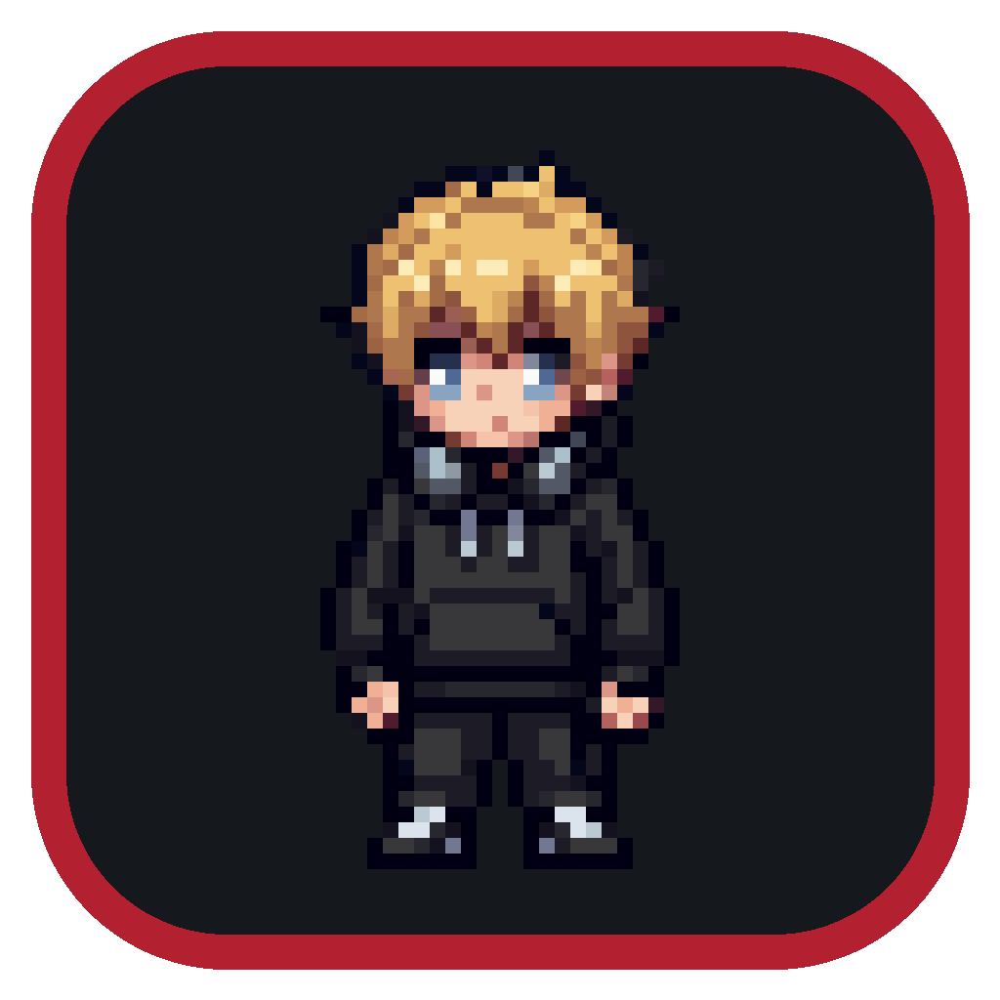
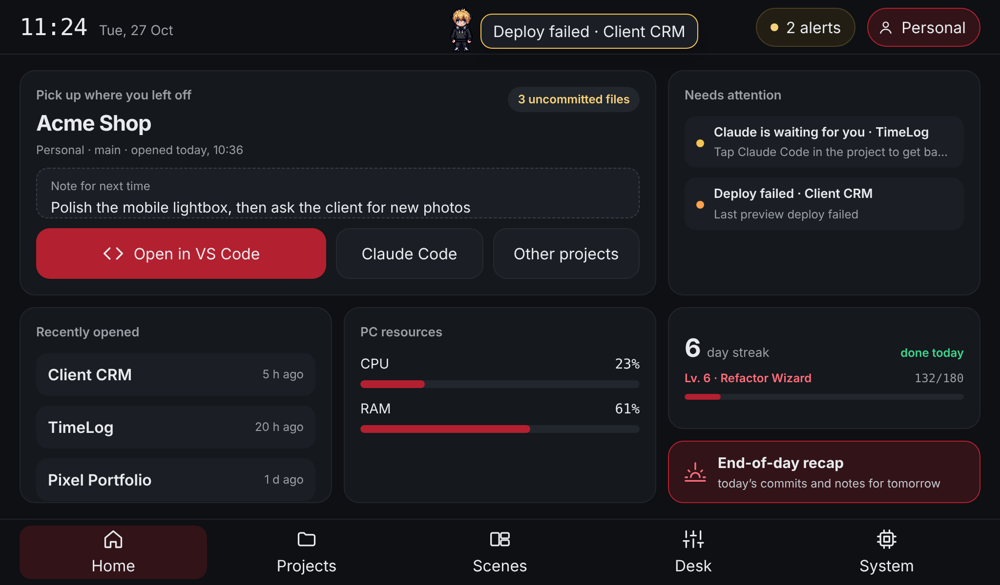
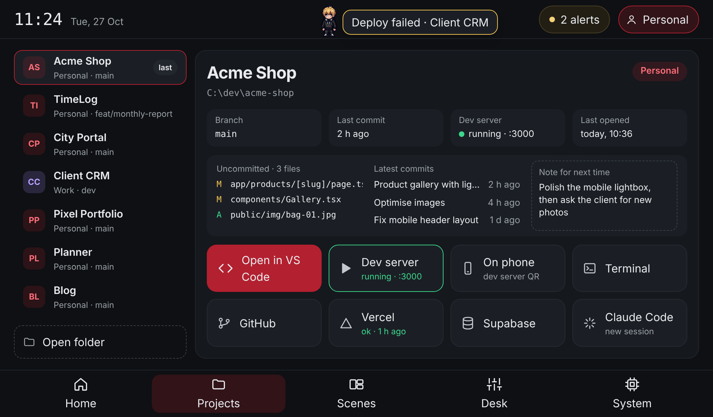
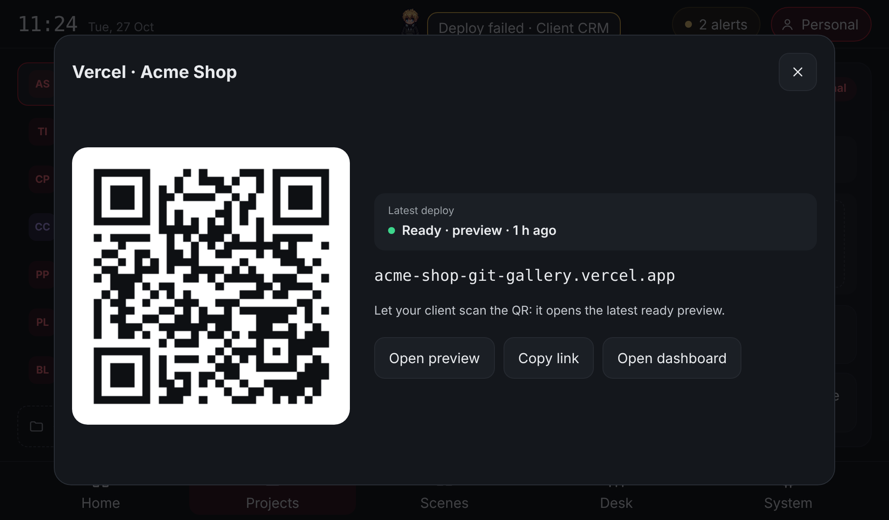
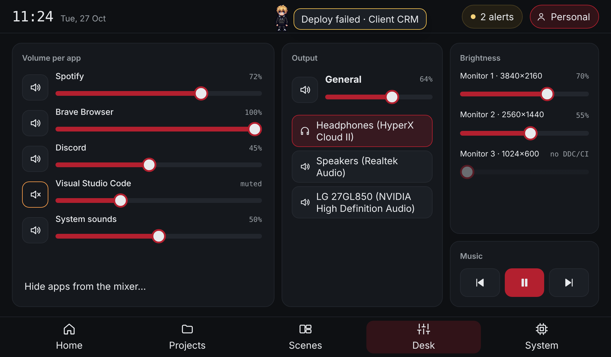
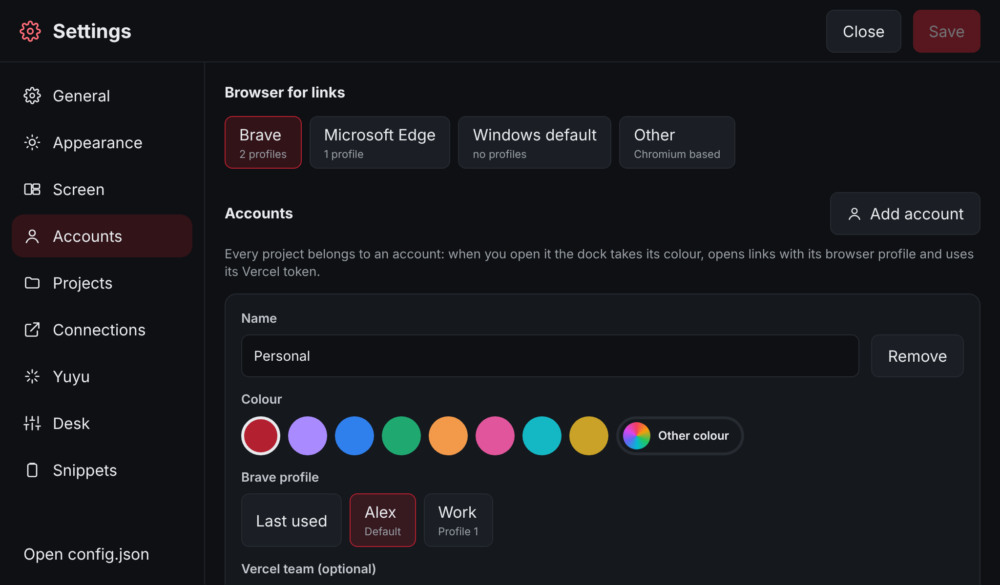
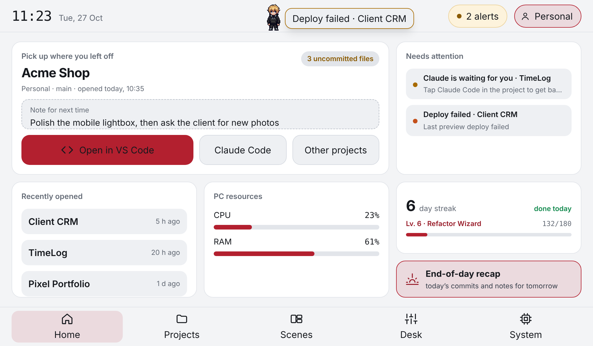
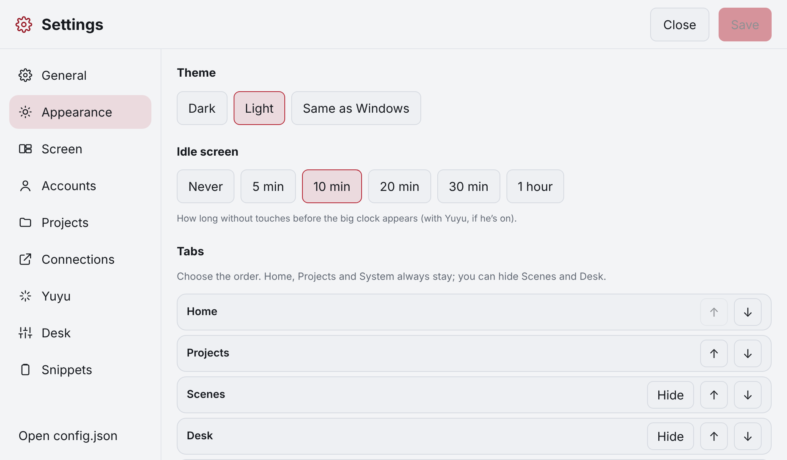
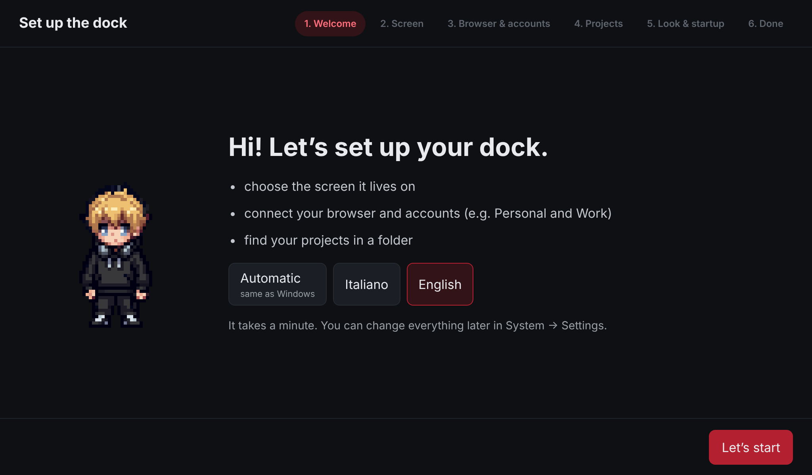
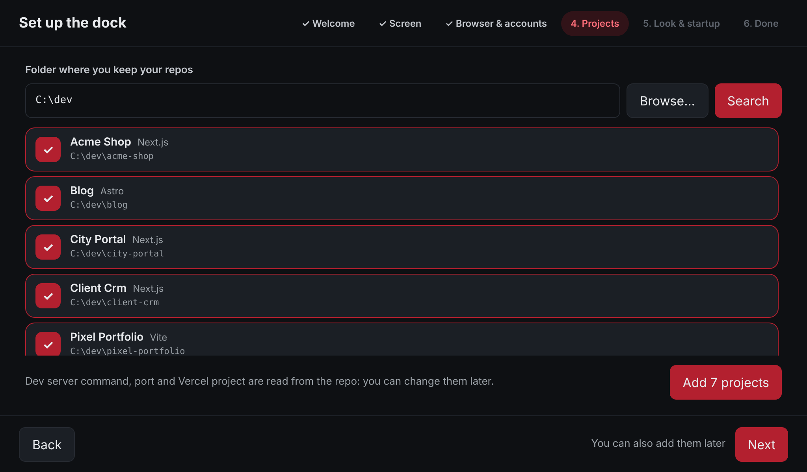

<p align="center">
  
</p>

<h1 align="center">Nockdock</h1>

<p align="center">
  A touch dashboard for the small screen under your monitors: open projects, follow Claude Code,
  check deploys and control your desk with one tap.<br />
  <a href="README.it.md">Leggi in italiano</a>
</p>

<p align="center">
  
</p>

Nockdock is an Electron app for Windows designed for a 7" touch screen (1024×600, like the Waveshare 7inch HDMI LCD (H)) placed between or under your monitors. It works like a Stream Deck that knows your projects: it reads your git repos, starts dev servers, opens VS Code, the terminal and Claude Code, shows Vercel deploys and lets you control audio and monitors. A small pixel-art mascot, Yuyu, walks along the top bar and reacts to what you do.

No touch screen? It runs just as well in a normal 1024×600 window.

## Features

- **Projects**: branch, uncommitted files and latest commits for every repo; one tap for VS Code, terminal, Claude Code, GitHub, Vercel, Supabase and the dev server. A **note for next time** for each project.
- **On your phone**: starts the dev server on the network and shows a QR code to open it on your phone.
- **Vercel**: latest deploy and a **QR code of the latest ready preview** to show to clients.
- **Claude Code**: through hooks, the dock (and Yuyu) knows when Claude is working, waiting for you or done.
- **Accounts**: up to 4 (e.g. Personal and Work), each with its own colour, browser profile (Brave, Chrome, Edge) and Vercel token. The dock switches account when you open a project.
- **Desk**: per-app volume, master volume, audio output switching, monitor brightness (DDC/CI) and media keys.
- **Scenes**: installed Steam games with covers and your Twitch channels when they are live.
- **End-of-day recap**: today's commits across all repos and notes for tomorrow.
- **Commit streak and levels**, idle screen with a big clock, snippets to copy, screenshot and lock PC.
- **Guided setup** on first launch and full **Settings** on the dock itself: no config files to edit.
- **Make it yours**: dark or light theme (or follow Windows), any accent colour per account, tab order, which Home cards and project buttons to show, custom links per project, and Yuyu can be turned off.
- **English and Italian**, automatic from Windows or chosen in Settings.

<p align="center">
  
  <br />
  
  <br />
  
  
</p>

## Requirements

- Windows 10 or 11
- Optional: a small touch screen (any resolution: the 1024×600 layout scales to fit)
- For the project features: Git, VS Code with the `code` command, Windows Terminal (built into Windows 11)
- Optional: Claude Code, Claude Desktop, Steam, a Vercel account, a Twitch app

## Install

Download the installer from the [latest release](https://github.com/yvr1x02/nockdock/releases/latest) and run it.

The installer isn't code-signed yet, so Windows SmartScreen may show "Windows protected your PC": click **More info → Run anyway**. If you'd rather check the code first, build it yourself (below).

On first launch the **guided setup** asks for:

1. **Screen**: which monitor is the dock (or a normal window).
2. **Browser and accounts**: Brave, Chrome and Edge are detected with their profile names.
3. **Projects**: pick the folder with your repos; projects are found automatically, with dev server command, port and Vercel project worked out from each repo.
4. **Look and startup**: theme, the Yuyu mascot (optional), idle screen and start with Windows.

Tokens, Twitch, Steam and Claude Code hooks can be added later in **Settings → Connections**.

<p align="center">
  
  
</p>

## Build from source

You need Node.js 22+ and pnpm (`npm i -g pnpm`).

```powershell
git clone https://github.com/yvr1x02/nockdock.git
cd nockdock
pnpm install
pnpm dev        # run in development
pnpm dist       # build the Windows installer in dist\
```

If pnpm asks to approve install scripts, approve `electron`.

## Connections

Tokens are encrypted with your Windows account (Electron `safeStorage`) and stored in `%APPDATA%\Nockdock\secrets.json`, never in the config file and never shown in the interface.

- **Vercel**: one token per account (vercel.com → Account Settings → Tokens). If an account's projects live in a team, add the team ID (`team_…`) in Settings → Accounts.
- **Claude Code**: in Settings → Connections tap _Copy the hooks_ and paste them into `%USERPROFILE%\.claude\settings.json` (merge with any existing `"hooks"`). The dock only listens on `127.0.0.1:47321`.
- **Twitch**: register an app on dev.twitch.tv (category "Application Integration", redirect `http://localhost`), then add Client ID, Client Secret and channels.
- **Steam**: libraries are found automatically.

## The Desk tab

The Desk tab talks to Windows through a small C# helper ([`src/main/win/DockHelper.cs`](src/main/win/DockHelper.cs)) that PowerShell compiles once, the first time you open the tab, and then keeps running in the background. Nothing needs to be installed. Brightness only works on monitors with DDC/CI enabled (usually a setting in the monitor's own menu).

## Configuration

Everything can be changed from the dock in **System → Settings**. The configuration also lives in `%APPDATA%\Nockdock\config.json` for anyone who prefers editing it by hand: the dock reloads it when you save. Notes and app state are in `state.json`, never in your repos.

## Translations

The interface uses the Italian text as the translation key and [`src/shared/i18n-en.ts`](src/shared/i18n-en.ts) holds the English text. A test fails if a string has no English version. To add a language, see [CONTRIBUTING.md](CONTRIBUTING.md).

## Development

| Command          | What it does                |
| ---------------- | --------------------------- |
| `pnpm dev`       | Run the app with hot reload |
| `pnpm build`     | Compile into `out\`         |
| `pnpm dist`      | Build the Windows installer |
| `pnpm typecheck` | Type check                  |
| `pnpm lint`      | ESLint                      |
| `pnpm test`      | Vitest                      |

Set `DOCK_WINDOWED=1` to force a normal window even when the dock screen is connected.

```
src/
  main/       main process: window, config, git, actions, dev servers, Windows helper
  preload/    safe bridge between the interface and the main process
  renderer/   React interface (screens, panels, settings and setup)
  shared/     shared types and translations
scripts/      generator of Yuyu's animations from the original GIF
```

Stack: Electron, React 19, Tailwind CSS v4, TypeScript, electron-vite, Vitest.

## Yuyu

Yuyu's animations are generated from the original pixel-art GIF in [`scripts/`](scripts) with `scripts/buddy_gen.py` (Python 3, Pillow, NumPy):

```powershell
python scripts/buddy_gen.py scripts/buddy-source.gif src/renderer/src/assets
```

## License

[MIT](LICENSE). The Yuyu character art is by the project's author and is included under the same license.
